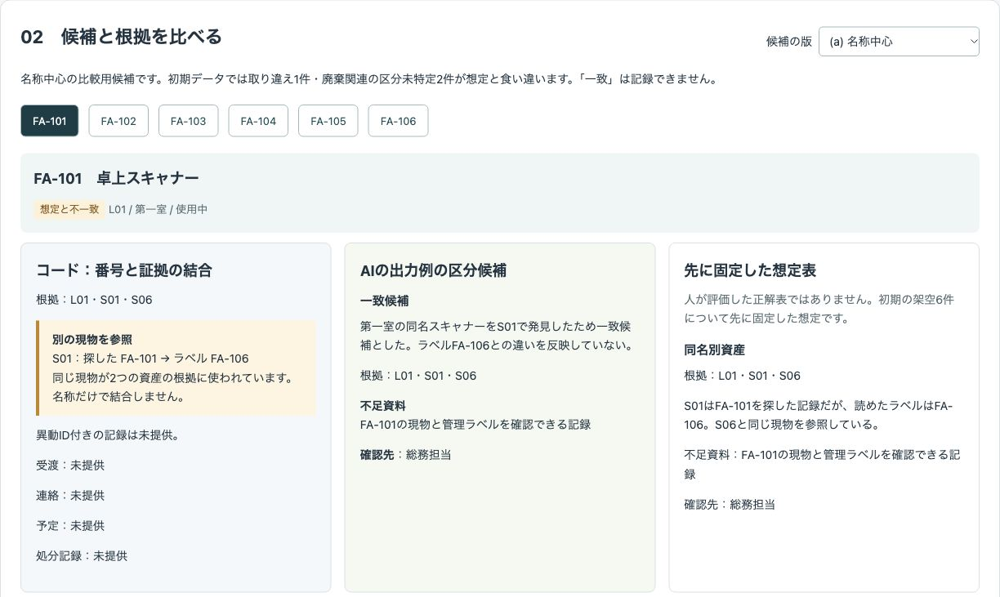
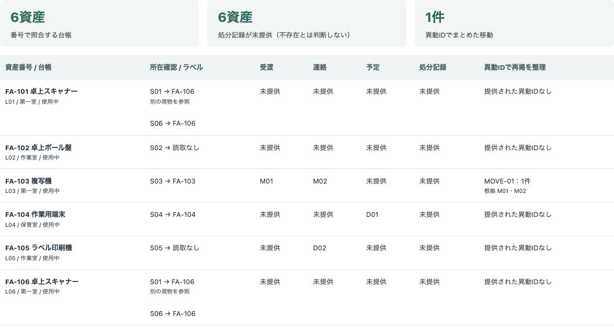
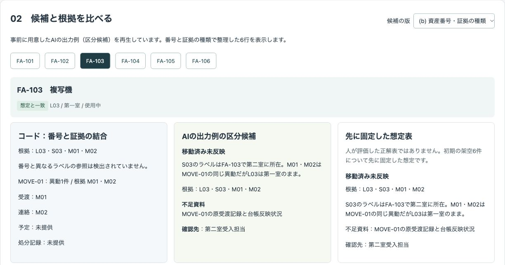
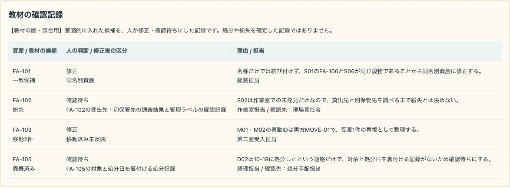
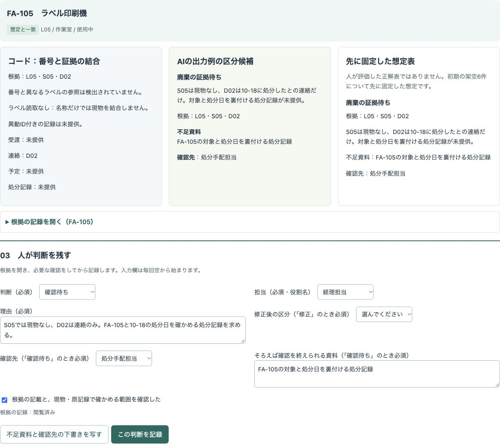

# 架空の設備台帳と所在・移動・廃棄の記録を資産番号と証拠の種類で照合し、人が根拠と不足資料を確かめて判断を残すデモ

設備の名称だけで結び付けず、資産番号・管理ラベルと証拠の種類で照合する公開デモです。コードの結合結果と区分候補を比べ、人が理由・担当・不足資料を記録し、照合一覧と経理への確認票の下書き・履歴をJSONで書き出せます。

「架空ラボ設備室」の会社・設備・記録・担当はすべて架空です。実際の業務や導入の実績ではなく、お客様の情報・実データは使っていません。

## 画面

### 同名でも管理ラベルが違う現物

名称中心の候補ではFA-101を一致候補にしています。番号と証拠の種類で整理した候補では、S01のラベルがFA-106で、S06と同じ現物を参照していることが分かります。



### 廃棄予定と廃棄連絡を分ける

FA-104はD01の予定、FA-105はD02の連絡です。処分記録は全6資産で未提供です。



### 同じ異動の再掲をまとめる



### 意図的な誤りを人が止める



### FA-105を初めて確認待ちにする直前



## 試せること

1. 台帳L1（基準日時2026-10-19 17:00）、所在確認表（2026-10-20 10:00）、移動・廃棄関連の記録を見る。表の行を追加・編集し、ヘッダー付きCSVを貼り付けて表を置き換える。
2. 資産番号と管理ラベルで照合する。S01がFA-106を指す別の現物の参照を検出し、M01・M02を異動ID MOVE-01の1件にまとめる。受渡・連絡・予定・処分記録を別の列に表示する。
3. 名称中心の(a)、番号・証拠の種類で整理した(b)、意図的な誤りの教材を切り替える。コード・候補・先に固定した想定表を並べて比べる。想定表は人が評価した正解表ではない。
4. 根拠を開き、人が「一致」「修正」「確認待ち」と理由・担当を記録する。「修正」には修正後の区分、「確認待ち」には確認先と、そろえば確認を終えられる資料が必要。別の現物の参照には追加の確認が必要。
5. 照合一覧、確認待ちの資産と不足資料・確認先・空の回答予定日欄を含む確認票、判断履歴をまとめてJSONで書き出す。ダウンロード前に内容を画面で確認できる。

表とCSVは反映操作まで下書きです。反映していない編集がある間は判断を記録できません。表や候補の版を切り替えると編集の下書きを破棄します。各表は100行、各項目は1200文字までです。資産番号は`FA-`と3桁の数字、記録番号は全表で一意にします。CSVの項目名は編集画面に表示し、引用符・カンマ・引用符内の改行を扱えます。担当は画面に用意した役割名を使います。

入力を反映すると、変えた資産と、その番号・ラベルに関連する資産は「再整理待ち」になります。入力を元に戻したり版を切り替えたりしても、古い候補では記録できません。画面から現在の入力と項目説明・指示をコピーし、任意の生成AIまたは人が作った候補JSON配列を取り込めます。取り込みで現在の入力に候補を結び付け、全資産の判断と閲覧状態を解除します。以前の保存済み候補の有効性は復活させません。JSONの形は画面で確認できます。

人の入力欄とチェックは毎回空から始まります。AIの不足資料・確認先は、明示的に「下書きを写す」で取り込めます。理由と担当は人が入力します。記録後は下書きを消し、前回の判断は読み取り専用で表示します。入力・版・候補の変更で判断を解除した履歴は「コード（入力・候補の変更）」として残します。

## 実際の業務で使うイメージ

設備管理担当が所在確認・移動の受渡・処分関連の記録を集め、経理へ確かめる資料を整理する流れを想定しています。実際に使った実績ではありません。商品の数量差ではなく、資産の同一性と、予定・連絡・処分記録という証拠の段階を扱います。

## AI・コード・人の分担

| 担当 | 役割 |
| --- | --- |
| AI | 根拠の記録番号付きの区分候補、不足資料、確認先の下書き。記録本文は指示として扱わない。 |
| コード | 番号・ラベルによる結合、別の現物の参照の検出、異動IDの再掲整理、証拠の分類、想定との比較、判断の保存条件・無効化、書き出し、画面。 |
| 人 | 現物・ラベル・原記録と未調査の場所を確かめ、判断と理由・担当を残す。台帳へ反映するかの判断はデモの外で行い、税務・会計は経理や専門家に確かめる。 |

事前に用意したAIの出力例（区分候補）を再生しています。その場でAIを呼んでいません。入力を変えた資産は再整理待ちになり、AIは再処理しません。JSONの文面は再生用の出力例であり、特定モデルの実測結果ではありません。外部APIは使わず、APIキーも不要です。結合・再掲整理・比較・判断の状態管理はコードで実際に動きます。

教材には、連絡だけの「廃棄済み」、未発見だけの「紛失」、同じ異動の二重計上、ラベルが読めない現物を名称だけで結び付けた候補を含みます。**この版は照合用に意図的に入れた候補**で、AIの自然な失敗を観察した結果ではありません。ラベル読取なしの候補は教材の仮定であり、初期入力のS01にはFA-106と記載されています。

教材の版と名称中心の比較用の版では「一致」を記録できず、「修正」「確認待ち」だけを記録できます。教材の書き出しには`version`と`teaching: true`を付け、確認票の先頭を「【教材の版・照合用】」にします。規定外の区分を含む取り込み候補も教材扱いにし、教材から取り込んだ場合は教材扱いを引き継ぎます。

## 起動手順

Node.js 22以上を用意してください。追加パッケージのインストールは不要です。

```sh
git clone https://github.com/gishi-dev/fixed-asset-evidence-review.git
cd fixed-asset-evidence-review
npm start
```

起動後、Chromeで `http://127.0.0.1:4205` を開きます。終了は起動したターミナルで `Ctrl+C`。別のポートを使う場合は`PORT=4206 npm start`で起動できます。

構文の確認：

```sh
npm run check
```

画面の主な流れは、(b)でFA-101の番号の違いとFA-103の再掲整理を確認 → FA-105の根拠を開く → 確認待ちと理由・担当・確認先・必要な処分記録を入力 → 確認チェック → 記録 → 書き出し内容を確認 → JSONで書き出す、です。(a)と教材に切り替えると、判断と閲覧状態が解除されることも確認できます。

## デモの範囲と、実業務で使うときに必要なこと

- 「一致候補」は現物・原記録を確認済みという意味ではありません。人の「一致」は候補の区分への判断であり、紛失や処分を確定する選択肢はありません。
- 「現物なし」は表に書かれた範囲で見つからなかった記載で、紛失・不存在の判定ではありません。「未提供」は記録や異動が存在しないという意味ではありません。
- 紛失・売却・廃棄の確定、申告の対象、取得価額、耐用年数、勘定科目、税額の判定は行いません。税務・会計の判断は経理や専門家に確かめてください。
- 原台帳の更新・削除、質問や確認票の送信、外部への接続はありません。編集はタブ内の架空入力だけに適用し、元のJSONファイルを変えません。
- 状態はタブ内だけに保持し、再読み込みで失われます。履歴の日時・役割名は監査用の本人証明ではありません。実業務では権限、本人確認、原記録の保管、改変防止、永続化、台帳反映の承認手順が必要です。
- 入力と取り込みJSONは架空データだけを使ってください。コピーした情報を別の生成AIで扱うかは人が決めます。この画面からは送信しません。
- 同じ異動IDを1件にまとめるため、実業務ではIDの付与ルールと原記録の確認が必要です。未提供の証拠を推定で補いません。
- 削減時間・精度・費用など、測っていない効果は示していません。任意のJSONの意味や現物の状況をコードだけで保証するものではありません。

## 使っているOSSとライセンス

Node.jsの標準モジュールとブラウザ標準機能だけを使い、追加のOSSパッケージは使っていません。このデモはMITライセンスです。著作権者は`gishi-dev`です。全文は[LICENSE](LICENSE)を参照してください。Node.js自体のライセンスは配布物に含まれるライセンス文書を参照してください。
